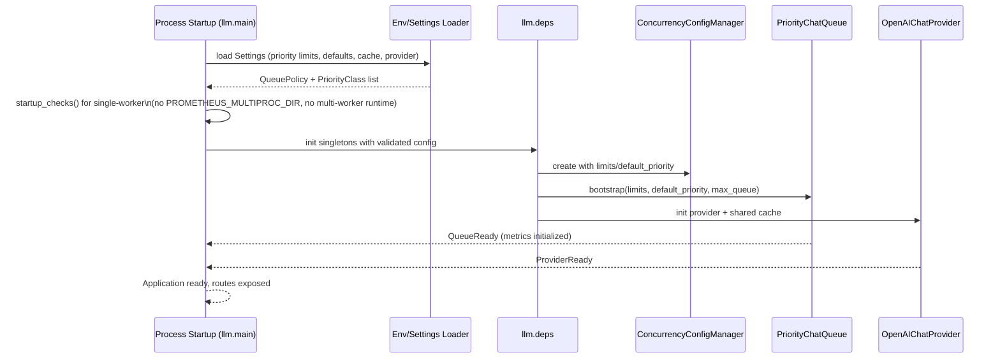

# Story Description LLMPROXY-1 — Enforce single-worker startup and initialize priority resources

## 0 - Общее описание
Цель истории — гарантировать запуск LLM Proxy Core строго в однопроцессном режиме и поднять единичные экземпляры приоритетной очереди, провайдера и кэша до приёма любых запросов. Это предотвращает рассинхронизацию счётчиков Prometheus и нарушений лимитов inflight/очереди. User Story: «Как оператор, я хочу, чтобы сервис стартовал только в поддерживаемой однопроцессной конфигурации и инициализировал приоритетные зависимости один раз, чтобы метрики и лимиты были консистентны для всех запросов». Подход: проверка окружения и конфигурации на старте, загрузка политик приоритетов через Settings Loader, инициализация `PriorityChatQueue`, `OpenAIChatProvider` и общего кэша как singletons.

## 1 — Матрица задач
| 📦 Сервис | 🎯 Что делать | ✅ Критерий готовности |
|-----------|--------------|------------------------|
| llm.main (application) | Выполнить стартовые проверки однопроцессного режима (отсутствие `PROMETHEUS_MULTIPROC_DIR`, несовместимых воркеров/пула процессов) и завершить процесс с осмысленной ошибкой при нарушении | Запуск в неподдерживаемом многопроцессном окружении завершается отказом до инициализации роутеров; сообщение об ошибке фиксирует причину |
| llm.deps (infrastructure) | Загрузить и провалидировать `QueuePolicy`/`PriorityClass` из Settings, создать singletons `PriorityChatQueue`, `OpenAIChatProvider`, кэша и `ConcurrencyConfigManager` | После старта доступна единичная инстанса каждого компонента; очередь содержит применённые лимиты и дефолтный приоритет |
| PriorityChatQueue (domain) | Применить лимиты приоритетов и `max_queue`, подготовить метрики очереди и inflight | Снимок очереди отражает корректные лимиты; метрики инициализированы без значений из прошлого запуска |
| Settings Loader / ConcurrencyConfigManager | Валидировать конфигурацию приоритетов (положительная ёмкость, дефолт существует) и передать её в очередь | Некорректные конфиги блокируют старт с явным кодом ошибки; валидный конфиг применён до открытия эндпоинтов |

## 2 — Контракты по сервисам
### 2.1 llm.main
| # | Method & Route | Auth (RBAC) | Input | Output | Idempotent | Side-effects |
|---|----------------|-------------|-------|--------|------------|--------------|
| 1 | `startup_checks()` | n/a | Env vars, process model | `StartupReady` \| `StartupRejected` | Да | Прекращает процесс при нарушении однопроцессного инварианта |
**Формат ошибки**
`{"code": "multiprocess_detected", "messageKey": "startup.multiprocess.forbidden", "details": "<detected setting>"}`  
`{"code": "priority_config_invalid", "messageKey": "startup.priority.invalid", "details": "<reason>"}`  
`{"code": "cache_init_failed", "messageKey": "startup.cache.failed", "details": "<exception>"}`  

### 2.2 llm.deps
| # | Method & Route | Auth (RBAC) | Input | Output | Idempotent | Side-effects |
|---|----------------|-------------|-------|--------|------------|--------------|
| 1 | `get_priority_queue()` | n/a | Validated `QueuePolicy`, `PriorityClass[]` | Singleton `PriorityChatQueue` | Да (singleton) | Создаёт очередь, поднимает метрики |
| 2 | `get_chat_provider()` | n/a | Provider settings, cache handle | Singleton `OpenAIChatProvider` | Да (singleton) | Инициализация клиента и кэша |
| 3 | `get_concurrency_config_manager()` | n/a | Priority limits map, default priority | Singleton `ConcurrencyConfigManager` | Да (singleton) | Делится состоянием лимитов |
**Формат ошибки**
`{"code": "dependency_init_failed", "messageKey": "deps.init.failed", "details": "<component>"}`  

### 2.3 PriorityChatQueue
| # | Method & Route | Auth (RBAC) | Input | Output | Idempotent | Side-effects |
|---|----------------|-------------|-------|--------|------------|--------------|
| 1 | `bootstrap(limits, default_priority, max_queue)` | n/a | PriorityClass map, defaults | `QueueReady` | Да | Заполняет внутренние лимиты, регистрирует метрики |
**Формат ошибки**
`{"code": "priority_limits_invalid", "messageKey": "queue.limits.invalid", "details": "<reason>"}`  

## 3 — Модели данных
- **QueuePolicy**: `{default_priority: string NOT NULL, max_queue: int NOT NULL, cache_settings: object, provider_defaults: object}`; ограничения — `default_priority` входит в `PriorityClass.code`, `max_queue >= -1`.
- **PriorityClass**: `{code: string PRIMARY KEY, inflight_capacity: int NOT NULL CHECK (>=0), queue_capacity: int NOT NULL CHECK (>=0), enabled: bool NOT NULL}`; должны существовать хотя бы один `enabled=True` и положительная `inflight_capacity` или `queue_capacity` для дефолтного класса.
- **RequestAdmission** (стартовый объект решения): `{id: UUID, decision: enum, reason: text, evaluated_at: datetime}` — используется для фиксации отказа старта при неверной конфигурации.
- **QueueMetricsSnapshot**: `{captured_at: datetime, queue_depth_total: int, inflight_total: int, per_priority_stats: jsonb, latency_histogram: jsonb}` — инициализируется пустыми значениями при старте.

## 4 Sequence Diagram

## 5 Edge Cases & Error Codes
- Обнаружен `PROMETHEUS_MULTIPROC_DIR` или многопроцессный воркер → `{"code":"multiprocess_detected","messageKey":"startup.multiprocess.forbidden","details":"env PROMETHEUS_MULTIPROC_DIR=/path"}`.
- Дефолтный приоритет отсутствует в конфиге → `{"code":"priority_config_invalid","messageKey":"startup.priority.invalid","details":"default_priority missing in limits map"}`.
- Все приоритеты имеют нулевые ёмкости → `{"code":"priority_limits_invalid","messageKey":"queue.limits.invalid","details":"no enabled priorities with capacity"}`.
- Ошибка инициализации кэша или провайдера → `{"code":"cache_init_failed","messageKey":"startup.cache.failed","details":"sqlite open failed"}`.

## 6 Business logic
1. На старте `llm.main.startup_checks()` валидирует отсутствие многопроцессного окружения (переменные, параметры запуска), логирует и прерывает процесс при нарушении.
2. Settings Loader загружает карту приоритетов (`llm_priority_limits_map`), `llm_priority_default`, `llm_queue_max_len`, параметры кэша и провайдера; проверяет, что дефолт входит в карту, есть включённые приоритеты с ёмкостью.
3. `llm.deps` создаёт singleton `ConcurrencyConfigManager` с валидированными лимитами и дефолтом, далее инициализирует `PriorityChatQueue.bootstrap()` с лимитами/inflight/`max_queue`.
4. `llm.deps` инициализирует общий кэш и `OpenAIChatProvider`, связывая его с кэшем и дефолтами модели.
5. При успешной инициализации очередь и метрики доступны роутерам; при любой ошибке старт останавливается с кодом и сообщением.

## 7 Non-Functional Requirements
- **SLA запуска**: проверка и инициализация должны завершаться до открытия портов; при ошибке сервис не должен принимать трафик.
- **Масштабирование**: поддерживается только один воркер/процесс; запуск с пулом процессов запрещён.
- **Observability**: логирование причин отказа старта; метрики очереди инициализированы нулями и готовы к `/metrics`.
- **Безопасность конфигурации**: недопустимые приоритеты блокируют старт; значения лимитов должны быть >=0.

## 8 Aceptance Criteria
- При наличии `PROMETHEUS_MULTIPROC_DIR` или обнаружении многопроцессного воркера процесс завершается до поднятия маршрутов с ошибкой `startup.multiprocess.forbidden`.
- При отсутствии дефолтного приоритета или нулевых ёмкостях старт завершается с кодом `startup.priority.invalid` или `queue.limits.invalid`.
- При валидной конфигурации старт завершается успешно: `PriorityChatQueue`, `OpenAIChatProvider`, кэш и `ConcurrencyConfigManager` доступны как singletons; метрики очереди показывают нулевые значения.
- Роуты `/v1/chat/completions`, `/v1/chat/invoke`, `/llm`, `/metrics` становятся доступными только после успешной инициализации.

## 9 Dependencies
- Settings Loader с доступом к переменным окружения и конфигурации приоритетов.
- Конфигурация провайдера и кэша (например, доступность пути SQLite).
- Процесс-менеджер, позволяющий запуск в однопроцессном режиме (uvicorn single worker).  
Других зависимостей: Нет.

## 10 Interfaces & Contracts
- Сторонние системы/API: OpenAI-совместимый провайдер (используется `OpenAIChatProvider`), Prometheus scrapers для `/metrics`.
- Auth: не применяется к стартовым проверкам; доступ к конфигурации ограничивается окружением.
- Протоколы: HTTP для последующих эндпоинтов, файловый доступ для кэша.
- Ограничения: многопроцессные раннеры (gunicorn with multiple workers, uvicorn --workers>1) запрещены; `PROMETHEUS_MULTIPROC_DIR` не должен быть установлен.

## 11 Reference Links
- `docs/features/llm-proxy-core/spec.md`
- `docs/features/llm-proxy-core/internals/use_cases.yaml` (UC-5)
- `docs/features/llm-proxy-core/internals/data_model.yaml`
- `docs/features/llm-proxy-core/internals/flows.yaml`
- `docs/features/llm-proxy-core/internals/dfd.md`
- `docs/features/llm-proxy-core/internals/integrations.yaml`

## 12 Open Questions
- Нужно ли проверять конкретные процесс-менеджеры (например, gunicorn с >1 воркером) или достаточно переменных/флагов окружения?
- Требуется ли fallback на ограниченный режим метрик (без Prometheus) вместо падения при мультипроцессе?

## 13 Proposed ADRs
- ADR: «Single-worker invariant for queue metrics» — зафиксировать запрет мультипроцессного режима и необходимость явного падения при нарушении.
- ADR: «Startup dependency initialization order» — описать порядок загрузки Settings → лимиты → очередь → провайдер → роутеры.

## 14 Appendix
- Ключевые настройки: `llm_priority_limits_map`, `llm_priority_default`, `llm_queue_max_len`, `PROMETHEUS_MULTIPROC_DIR`, параметры кэша (`llm_cache_*`), дефолты провайдера (`llm_default_model`, `llm_temperature`, `llm_top_p`).
