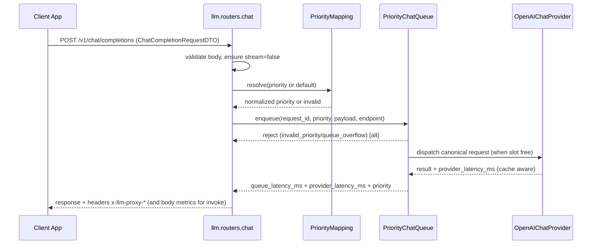

# Story Description LLMPROXY-2 — Priority admission for chat completions with queue metrics

## 0 - Общее описание
История направлена на приём OpenAI-совместимых чат-запросов через `/v1/chat/completions` с явной приоритезацией, соблюдением лимитов inflight/очереди и возвратом метрик выполнения. Ожидаемый результат — каждый запрос получает `request_id`, проходит проверку приоритета и лимитов, либо отклоняется с предсказуемым кодом, а успешные ответы содержат заголовки `x-llm-proxy-*` с задержками очереди и провайдера. Подход основан на использовании `PriorityChatQueue` для приёмки и планирования, нормализации приоритета через `PriorityMapping` и выполнении через `OpenAIChatProvider` с общим кэшем.
User Story: «Как клиент LLM Proxy, я хочу отправлять чат-запросы с приоритетом и получать метрики очереди в ответе, чтобы понимать задержки и гарантировать предсказуемое обслуживание».

## 1 — Матрица задач
| 📦 Сервис | 🎯 Что делать | ✅ Критерий готовности |
|-----------|--------------|------------------------|
| llm.routers.chat (controller) | Принимать `POST /v1/chat/completions`, валидировать тело и `stream=False`, нормализовать приоритет, присваивать `request_id`, ставить в очередь и формировать ответ с заголовками метрик | Валидные запросы проходят в очередь, ответы содержат `request_id`, `x-llm-proxy-priority`, `x-llm-proxy-queue-latency-ms`, `x-llm-proxy-provider-latency-ms`; невалидные получают 400/429/500 по правилам |
| PriorityChatQueue (domain) | Применять лимиты inflight и `max_queue`, измерять задержку постановки/выполнения, освобождать слоты и обновлять счётчики | Переполнение или недопустимый приоритет возвращают отказ (`queue_overflow`/`invalid_priority`); принятые запросы выполняются в пределах слотов, метрики очереди отражают актуальное состояние |
| PriorityMapping (domain) | Нормализовать входной приоритет из заголовка/тела с учётом дефолта и отключённых значений | Неизвестные или отключённые приоритеты приводят к 400; валидные значения передаются в очередь |
| llm.services.chat_provider.OpenAIChatProvider (infrastructure) | Выполнять нормализованный запрос, используя дефолты модели/сэмплинга и общий кэш, измерять латентность | Успешный вызов возвращает результат с отметкой попадания в кэш (если есть); ошибки провайдера проксируются как 500 `provider_error` |
| llm.metrics.prometheus.router (controller) | Экспортировать метрики очереди/выполнения для контроля слотов и задержек | `/metrics` отражает очередь, inflight, задержки и overflow в формате Prometheus |

## 2 — Контракты по сервисам
### 2.1 llm.routers.chat
| # | Method & Route | Auth (RBAC) | Input | Output | Idempotent | Side-effects |
|---|----------------|-------------|-------|--------|------------|--------------|
| 1 | `POST /v1/chat/completions` | n/a | `ChatCompletionRequestDTO` + optional `X-Priority`/`priority` | OpenAI-совместимый ответ с заголовками `x-llm-proxy-*` | Нет | Генерирует `request_id`, ставит в очередь, обновляет метрики |
| 2 | `POST /v1/chat/invoke` | n/a | `ChatCompletionRequestDTO` + optional `X-Priority`/`priority` | Ответ с метриками в теле и заголовках (`InvokeResponseWithMetricsDTO`) | Нет | То же, что выше, плюс возврат метрик в теле |
**Формат ошибки**
`{"code": "invalid_priority", "messageKey": "chat.priority.invalid", "details": "<priority>"}`
`{"code": "queue_overflow", "messageKey": "chat.queue.overflow", "details": "max_queue=..."}`
`{"code": "streaming_not_supported", "messageKey": "chat.stream.unsupported", "details": "stream=true"}`
`{"code": "provider_error", "messageKey": "chat.provider.error", "details": "<upstream>"}`

### 2.2 PriorityChatQueue
| # | Method & Route | Auth (RBAC) | Input | Output | Idempotent | Side-effects |
|---|----------------|-------------|-------|--------|------------|--------------|
| 1 | `enqueue(request_id, priority, payload, endpoint)` | n/a | Normalized priority, canonical chat payload, endpoint tag | `AdmissionResult {accepted, rejected_reason}` | Нет | Регистрирует задержку, захватывает/освобождает слот, обновляет счётчики overflow/latency |
| 2 | `snapshot()` | n/a | none | `QueueMetricsSnapshot` | Да | Нет |
**Формат ошибки**
`{"code": "invalid_priority", "messageKey": "queue.priority.invalid", "details": "disabled or unknown"}`
`{"code": "queue_overflow", "messageKey": "queue.overflow", "details": "max_queue reached"}`

### 2.3 llm.services.chat_provider.OpenAIChatProvider
| # | Method & Route | Auth (RBAC) | Input | Output | Idempotent | Side-effects |
|---|----------------|-------------|-------|--------|------------|--------------|
| 1 | `invoke_chat(canonical_request)` | n/a | Normalized chat payload (model, messages, params, stream=false) | Provider response or cached value | Нет | Обновление кэша, измерение латентности |
**Формат ошибки**
`{"code": "provider_error", "messageKey": "provider.call.failed", "details": "<exception or status>"}`

### 2.4 llm.metrics.prometheus.router
| # | Method & Route | Auth (RBAC) | Input | Output | Idempotent | Side-effects |
|---|----------------|-------------|-------|--------|------------|--------------|
| 1 | `GET /metrics` | n/a | none | Prometheus text payload (`MetricsExpositionDTO`) | Да | Нет |
**Формат ошибки**
`{"code": "metrics_unavailable", "messageKey": "metrics.unavailable", "details": "<reason>"}`

## 3 — Модели данных
- **LLMRequest**: `{id: UUID PRIMARY KEY, endpoint: enum('chat_completions','chat_invoke','llm'), priority: string NOT NULL, model: string NOT NULL, messages: jsonb NOT NULL, temperature: float, top_p: float, max_tokens: int, stop: jsonb, stream: bool DEFAULT false CHECK(stream=false), status: enum(accepted, queued, running, completed, failed, rejected), received_at: datetime NOT NULL, enqueued_at: datetime, started_at: datetime, completed_at: datetime, queue_latency_ms: int, provider_latency_ms: int, cache_hit: bool, error_code: string}`; индексы: `(priority)`, `(status)`, `(endpoint)` для выборок метрик.
- **RequestAdmission**: `{id: UUID, decision: enum(accepted, rejected_overflow, rejected_invalid_priority, rejected_streaming), reason: text, evaluated_at: datetime, llm_request_id: UUID UNIQUE}` — фиксирует исход приёмки.
- **ObservabilityHeader**: `{request_id: UUID, queue_latency_ms: int, provider_latency_ms: int, priority: string, endpoint: string}` — формируется на выходе для заголовков `x-llm-proxy-*`.
- **InvokeResponseWithMetricsDTO**: `{request_id: string, output: object, queue_latency_ms: int, provider_latency_ms: int, priority: string}` — тело ответа `/v1/chat/invoke`.
- **QueueMetricsSnapshot**: `{captured_at: datetime, queue_depth_total: int, inflight_total: int, per_priority_stats: jsonb, latency_histogram: jsonb}` — источник для `/metrics` и заголовков.

## 4 Sequence Diagram

## 5 Edge Cases & Error Codes
- `invalid_priority, chat.priority.invalid, unknown_or_disabled` — приоритет не существует или имеет нулевую ёмкость.
- `streaming_not_supported, chat.stream.unsupported, stream=true` — вход с `stream=True` отклоняется.
- `queue_overflow, chat.queue.overflow, max_queue_exceeded` — достигнут предел `max_queue` либо `max_queue=0` без свободного слота.
- `provider_error, chat.provider.error, upstream_failed` — ошибка апстрима или кэша при выполнении.
- `bad_request, chat.body.invalid, validation_failed` — схема тела не проходит валидацию.

## 6 Business logic
1. Принять HTTP-запрос, распарсить `ChatCompletionRequestDTO`, запретить `stream=True`, применить дефолты модели/temperature/top_p при отсутствии значений.
2. Извлечь приоритет из заголовка/тела, передать в `PriorityMapping` для нормализации; неизвестные или отключённые приоритеты → 400 `invalid_priority`.
3. Сгенерировать `request_id`, зафиксировать `received_at`, подготовить canonical payload.
4. Вызвать `PriorityChatQueue.enqueue`; при `max_queue` переполнении вернуть 429 `queue_overflow`. При принятии очередь измеряет задержку ожидания слота.
5. Когда слот доступен, `PriorityChatQueue` отправляет canonical payload в `OpenAIChatProvider.invoke_chat`, учитывая кэш; измеряется `provider_latency_ms`.
6. После выполнения очередь освобождает слот, обновляет метрики (queue_latency, provider_latency, inflight/queue depth, overflow counters).
7. Контроллер формирует ответ: для `/v1/chat/completions` — в заголовках `x-llm-proxy-request-id`, `x-llm-proxy-priority`, `x-llm-proxy-queue-latency-ms`, `x-llm-proxy-provider-latency-ms`; для `/v1/chat/invoke` добавляет метрики в тело.
8. Ошибки провайдера или валидации оформляются с кодами 400/429/500 и `details`/`reason`, слоты освобождаются.

## 7 Non-Functional Requirements
- **SLA ответа**: минимизировать задержку валидации/приёмки; при переполнении немедленно возвращать 429 без блокировок.
- **Масштабирование**: работает в однопроцессном режиме; лимиты inflight/очереди конфигурируются через `Settings` и применяются к каждому запросу.
- **Observability**: обязательные заголовки `x-llm-proxy-*`, экспорт Prometheus метрик по глубине очереди, inflight, задержкам и overflow; request_id пригоден для трассировки.
- **Rate limits**: ограничение по приоритетам и `max_queue`, отсутствие поддержки стриминга; поведение детерминировано конфигурацией.
- **Надёжность**: освобождение слотов при любой ошибке выполнения; кэш не обходит очередь.

## 8 Aceptance Criteria
- `/v1/chat/completions` и `/v1/chat/invoke` принимают только `stream=False` и валидные приоритеты; при нарушении возвращают 400 с кодами `chat.priority.invalid` или `chat.stream.unsupported`.
- При `max_queue` превышении или `max_queue=0` без свободного слота запрос отклоняется 429 `chat.queue.overflow` без вызова провайдера.
- Успешные ответы содержат `request_id`, применённый приоритет и метрики очереди/провайдера в заголовках; `/v1/chat/invoke` дополнительно возвращает метрики в теле.
- Вызовы провайдера происходят только после успешного `enqueue`; слоты inflight освобождаются после завершения/ошибки, что отражено в `/metrics`.
- Ошибка апстрима проксируется как 500 `chat.provider.error` с сохранением метрик и освобождением слота.

## 9 Dependencies
- LLMPROXY-1 (единый воркер и инициализация singletons очереди/провайдера).
- Конфигурация приоритетов/лимитов из `Settings` (`llm_priority_limits_map`, `llm_priority_default`, `llm_queue_max_len`).
- Кэш и провайдер OpenAI-совместимого апстрима.

## 10 Interfaces & Contracts
- Сторонние системы/API: OpenAI-совместимый LLM провайдер; Prometheus scrapers для `/metrics`.
- Auth: публичные чат-эндпоинты без RBAC (по текущему контексту); админские интерфейсы не задействуются в истории.
- Протоколы: HTTP/JSON для входных/выходных DTO; Prometheus text для `/metrics`.
- Ограничения: однопроцессный режим; запрет stream; приоритеты ограничены конфигурацией.

## 11 Reference Links
- `docs/features/llm-proxy-core/spec.md`
- `docs/features/llm-proxy-core/internals/use_cases.yaml` (UC-1, UC-2)
- `docs/features/llm-proxy-core/internals/data_model.yaml`
- `docs/features/llm-proxy-core/internals/flows.yaml`
- `docs/features/llm-proxy-core/internals/dfd.md`
- `docs/features/llm-proxy-core/internals/integrations.yaml`

## 12 Open Questions
- Применять ли глобальный `llm_max_tokens` как дефолт при отсутствии `max_tokens` в запросе или оставлять ответственность клиенту?
- Нужен ли отдельный код/причина для запросов с приоритетом, у которого `inflight_capacity >0`, но `queue_capacity=0` (только мгновенное выполнение)?
- Требуется ли логировать метрики кэш-хитов отдельно в заголовках или достаточно внутренних метрик?

## 13 Proposed ADRs
- ADR: «Priority admission and queue metrics for chat endpoints» — зафиксировать обязательность прохождения через `PriorityChatQueue`, список возвращаемых заголовков и коды отказа.
- ADR: «Priority normalization contract» — документировать правила `PriorityMapping` (источник приоритета, дефолт, запрет нулевых ёмкостей).

## 14 Appendix
- Заголовки ответа: `x-llm-proxy-request-id`, `x-llm-proxy-priority`, `x-llm-proxy-queue-latency-ms`, `x-llm-proxy-provider-latency-ms`.
- Коды и причины отказов: `invalid_priority`, `queue_overflow`, `streaming_not_supported`, `provider_error`, `bad_request`.
- Метрики очереди: глубина по приоритетам, inflight, `queue_latency_ms`, `provider_latency_ms`, overflow counters, cache hit ratio (внутренняя).
